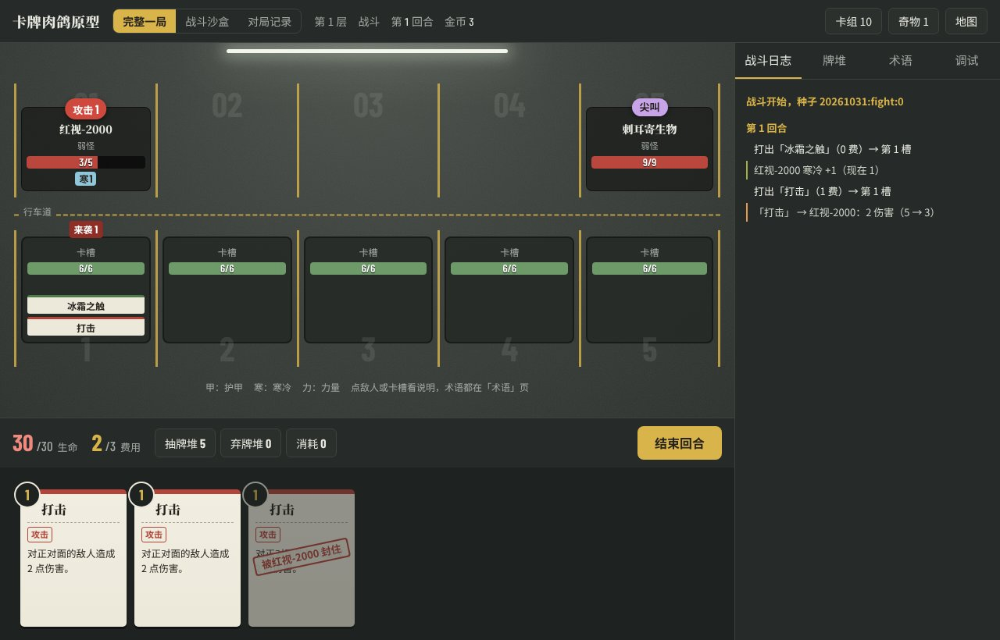
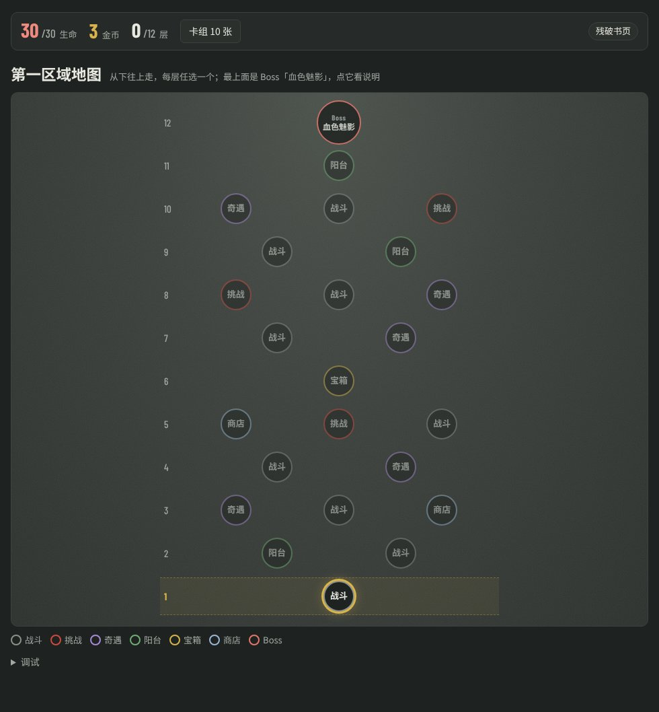

# 卡牌肉鸽原型

以「卡槽」为核心的卡牌肉鸽（Roguelike Deckbuilder）试玩原型。游戏名由原作者来定，目前还没有起。

**在线试玩：<https://roguelike-deckbuilder-2l5.pages.dev>**（电脑和手机浏览器都能玩，不用安装）



## 现在能玩什么

| 模式 | 内容 |
| --- | --- |
| 完整一局 | 第一区域一共 12 层：第 1 层打小怪，第 6 层是宝箱，第 11 层是阳台，第 12 层打 Boss 血色魅影；其余各层有 2 个或 3 个选项（交替出现；战斗、挑战、奇遇、阳台、商店），任选一个往上走。整张地图开局就能看到，在任何页面（包括战斗里）都能打开地图、奇物和卡组看；血量、卡组、金币、奇物一路带着走，进度存在浏览器里，刷新后可以接着玩。 |
| 战斗沙盒 | 单独打一场：自选敌人组合、改卡组、开关奇物，现场改数值和规则，锁血、无限费用，固定随机种子复现问题。 |
| 对局记录 | 每一局（和沙盒里的每一场）的记录和反馈问卷。可以下载成 JSON 文件，也可以导入别人发来的记录，汇总胜率、停在哪一层、卡牌选取率和问卷结果。 |

已经做进去的内容都来自策划表 `design/game-design.xlsx`：25 张牌、10 种敌人（含精英镜中人和 Boss 血色魅影）、9 个奇物、4 个奇遇。



## 基本规则

- 玩家 30 血，5 个卡槽各 6 血。每回合 3 费、抽 5 张，没用完的费用不留到下回合。
- 每张牌都要放进一个卡槽才算打出（点一张牌再点卡槽，或者直接拖过去）。一个卡槽一回合可以放好几张牌；暗影塑形这类持续型的牌和能力牌放下后会占住卡槽。
- 单体牌打这张牌所在卡槽正对面的敌人；敌人打它正对面的卡槽。护甲只护住所在的卡槽，下个回合开始时清零。
- 卡槽被打爆，你掉 6 血；之后再有东西打这一列，伤害直接落在你身上。

完整规则见 [design/rules.md](design/rules.md)。标「待确认」的条目是原型里先定下来的做法，还在等策划拍板。

## 测数值和找问题

- **战斗日志**：战斗右侧会写清每一步伤害是怎么算的，包括护甲、寒冷、力量和掷骰。
- **术语和状态说明**：牌上的术语（消耗、固有、保留、寒冷……）在卡组、卡牌奖励、商店里都列了说明，战斗里选中一张牌时也会显示；点敌人看它身上的状态，点自己的卡槽看这个卡槽的情况；战斗右侧还有「术语」页。
- **卡组预览升级**：卡组里可以切换成「升级后的效果」，看每张牌升级以后是什么样。
- **战斗里的调试**：锁血、无限费用、往手牌里加任意牌、抽牌、回满血、修好所有卡槽，还能看抽牌堆的顺序。
- **战斗沙盒设置页**：改玩家血量、卡槽血量、费用、抽牌数、手牌上限，每个敌人和每张牌的数字，以及「被打爆的卡槽能放哪些牌」。这些设置完整一局也用。
- **完整一局开局页**：改层数、宝箱层、随机层的选项数（2、3 交替或每层 3 个）、各类节点的比例、金币、阳台回血、每组卡牌奖励带梦想卡的概率、商店货量，以及「不扎堆」（同一类节点不连着出现 3 层，只有 2 个的阳台、商店不挨着）。地图页的「调试」里可以加金币、回满血、直接打 Boss、随便走。
- **随机种子**：同一个种子、同样的操作，结果完全一样。遇到问题时记下种子，就能复现。

## 收集试玩反馈

1. 试玩的人打完一局（输了、赢了都算），总结页下面有一份反馈问卷：好不好玩、难度、节奏、最好用和最没用的牌、最难对付的敌人，以及看不懂的规则和遇到的 bug。都是选填。
2. 点「提交问卷并下载记录」，会下载一个 JSON 文件，把它发给策划就行。
3. 策划打开「对局记录」，点「选记录文件」一次导入所有人发来的文件，下面的汇总会把它们算在一起：通关率、平均走到第几层、停在哪一层、选路、输在谁手上、奇遇怎么选、出牌次数、每张牌在卡牌奖励里的选取率，以及每道题的答案分布和所有文字回答。
4. 汇总好的记录可以「合并下载」成一个文件存档，下次直接导入这一个文件。

其他说明：

- 记录会自动存在浏览器里（完整一局最多留 20 份，沙盒最多 10 份），在「对局记录」里随时能补填问卷、看详情、下载。中途放弃的局也会留一份，记成「放弃」。
- 一份记录里有：这一局的种子和设置（包括有没有开锁血）、路线、每一步做了什么（进了哪个节点、奇遇怎么选、卡牌奖励给了哪几张拿了哪张、买了什么、删了什么）、每场战斗的摘要和完整日志、最后的卡组和奇物，以及问卷答案（连同题目一起存）。
- 在 claude.ai 里打开时，下载要先在弹出的提示里确认；下载不了就会把记录内容显示出来，复制下来发给策划也行。「对局记录」页也可以直接粘贴记录内容来导入。
- 问卷的题目在 `prototype/js/data.js` 的 `SURVEY` 里，可以直接加题、改题。

## 本地运行

不需要构建，下面两种方式任选一种：

- 直接用浏览器打开 `prototype/index.html`。
- 在仓库根目录起一个静态服务器，再打开 <http://localhost:8000/prototype/>：

```bash
python3 -m http.server 8000
```

改了规则代码之后，跑一下规则测试（需要 Node.js 18 或更新版本）：

```bash
node --test prototype/test/engine.test.js prototype/test/run.test.js prototype/test/record.test.js
```

## 改数据

- 策划原表是 `design/game-design.xlsx`。改完后重新生成能在 GitHub 上直接看的 Markdown 版（需要先 `pip install openpyxl`）：

```bash
python3 tools/xlsx_to_md.py design/game-design.xlsx design/game-design.md
```

- 原型实际用的数值在 `prototype/js/data.js`：卡牌（`params` 里每一项是「基础, 升级」两个数）、敌人、奇物、奇遇、完整一局的默认数，以及反馈问卷的题目。它和 xlsx 目前要手动保持一致。

## 目录

```text
design/
  game-design.xlsx      策划原表：敌怪、事件、卡牌、奇物
  game-design.md        原表的 Markdown 版（脚本生成，不要手改）
  rules.md              完整规则，按机制问卷的答复整理
prototype/
  index.html            试玩网页
  js/
    data.js             卡牌、敌人、奇物、奇遇的数据和默认数值，反馈问卷的题目
    rng.js              可复现的随机数
    engine.js           战斗规则（不含界面）
    run.js              完整一局：地图、奖励、奇遇、商店、阳台、宝箱（不含界面）
    record.js           对局记录的格式、导入和汇总（不含界面）
    ui-common.js        界面通用部分：设置存档、提示、弹窗、卡牌显示
    ui-combat.js        战斗画面（完整一局和沙盒共用）
    ui-records.js       对局记录页、反馈问卷、下载
    ui-sandbox.js       战斗沙盒
    ui-run.js           完整一局的各个页面
    ui-app.js           入口，切换三种模式
  test/                 规则测试
docs/
  mechanics-questionnaire.html  机制确认问卷（56 题，答复已整理进 rules.md）
  images/               README 里的截图
tools/
  xlsx_to_md.py         把 xlsx 导出成 Markdown
```

## 进度

- [x] 策划表整理、机制确认问卷、规则文档
- [x] 战斗沙盒
- [x] 第一区域完整一局
- [x] 对局记录和反馈问卷
- [ ] 策划确认 `design/rules.md` 里标「待确认」的条目，尤其是「被打爆的卡槽能放哪些牌」
